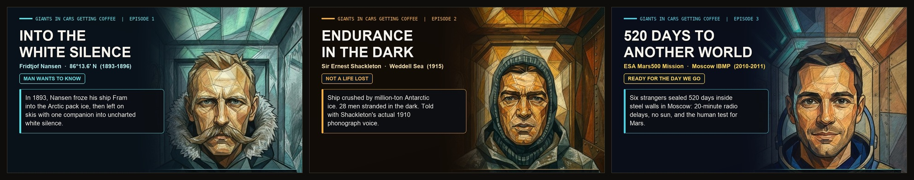
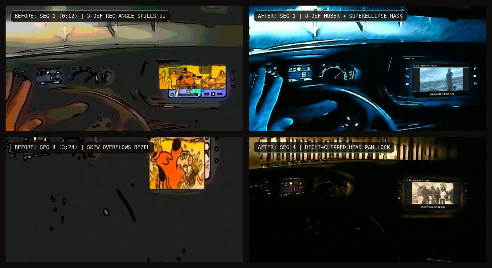
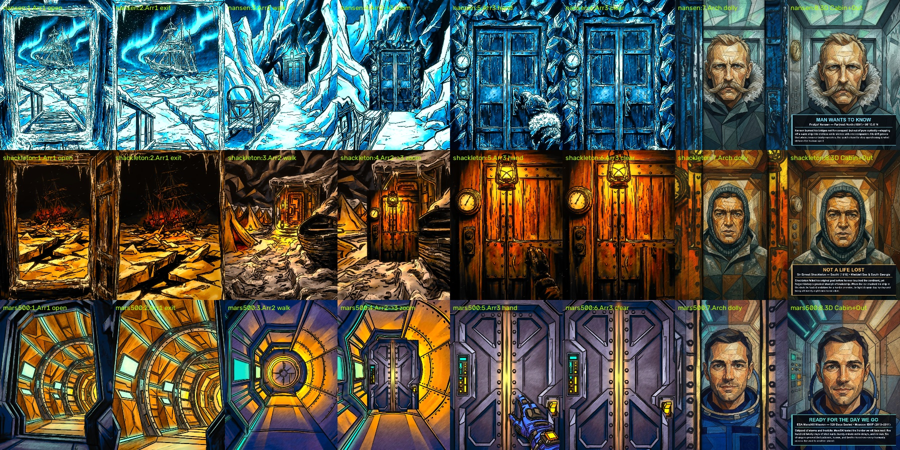

<!-- eyebrow: NOTES · VISION & AGENTS -->
# Night-Chalk Drive: a 12-fps rotoscope pipeline from Meta Ray-Ban night footage

*20 November 2026 · OpenCV, planar tracking, CIE-Lab shaders, 6-DoF pinhole projection*

While driving around Sabadell, Spain, at night, I recorded five short clips on my Meta Ray-Ban (Gen 2) glasses. I wanted to turn that ordinary drive into three *Take On Me* style animated shorts, now grouped as *Giants in Cars Getting Coffee*.

I've picked three real stories of crews going into extreme isolation and coming home alive: Fridtjof Nansen's *Fram* Arctic drift, Ernest Shackleton's *Endurance* survival, and the ESA Mars500 520-day mission.

An early coding-agent pass got a very rough color cartoon cut going and produced a first 3-DoF template tracker ([baseline_v1_template_tracker.py](https://github.com/macayaven/night-chalk-drive/blob/main/pipeline/baseline_v1_template_tracker.py)). Looking at the renders that came back, the car screen stickers would slide off the plastic bezel as soon as you turned your head, and the night sky would turn into gray noise. The ending still went through my actual garage to an elevator mirror.

I took over from that v1 prototype, left the raw video clips completely as they were, and rebuilt the tracker, the shader, the 3D portal endings, and the audio mix all into [github.com/macayaven/night-chalk-drive](https://github.com/macayaven/night-chalk-drive).

## What the pipeline outputs

The 5 raw MOV files total `1,125.55 s`. [pipeline/media_base.py](https://github.com/macayaven/night-chalk-drive/blob/main/pipeline/media_base.py) sorts them in chronological order (`1453 -> 1430 -> 1460 -> 1446 -> 1439`) and re-times the drive into a single `288.0 s` base plate at `720x960`, `24 fps`. The animation itself is at `12 fps`, so each pair of consecutive `24-fps` frames shares one geometry and one shade pose (`3,198` poses across the driving head up to `CAR_STOP_POSE = 2989`).

| Episode | Speed schedule | Look and ending | Runtime | Watch |
| --- | --- | --- | --- | --- |
| **Ep. 1: Fridtjof Nansen** (*Into the White Silence*) | Crisp hyper-lapse around `1.08x` | Silver-ice chalk, cyan aurora glow, wooden *Fram* cabin | `4:40` (`6,720` f) | [YouTube](https://youtu.be/viGtHeIcbxI) · [X](https://x.com/macayaven/status/2123420715965698298) |
| **Ep. 2: Sir Ernest Shackleton** (*Endurance in the Dark*) | Heavy pace slowing from `1.35x` to `0.38x` | Amber noir, warm bloom, *Endurance* timber deck & lantern | `4:00` (`5,760` f) | [YouTube](https://youtu.be/8sN2TDPnP0E) |
| **Ep. 3: ESA Mars500** (*520 Days to Another World*) | Slow dusk (`0.60x`) -> `1.65x` cruise -> `0.58x` unseal | Indigo CAD teal thawing to daylight gold | `4:15` (`6,120` f) | [YouTube](https://youtu.be/devbEUMNzms) |

<figure class="figure">
  
  <figcaption>The three episodes of Giants in Cars Getting Coffee: Episode 1 Fridtjof Nansen in Arctic silver-ice (left), Episode 2 Sir Ernest Shackleton in amber noir (center), and Episode 3 ESA Mars500 in teal-to-gold (right).</figcaption>
</figure>

The 15-second clip below shows the jump from raw glasses footage and the drifting v1 template matcher to the locked v2 tracker and finished trilogy.

<figure class="figure">
  <video controls playsinline preload="metadata" poster="tracker-comparison.jpg">
    <source src="debug-2x2.mp4" type="video/mp4">
  </video>
  <figcaption>15-second 2x2 cut across Segment 1 (0:12), a clipped head turn in Segment 4 (3:24), and the finale transition: (1) raw POV footage, (2) v1 prototype (drifting 3-DoF matcher and real elevator mirror), (3) v2 8-DoF Huber + LK track on driving windows and v1 2.5D sliding portal on the finale, and (4) the finished Night-Chalk episodes with 6-DoF 3D airlock. Note: raw POV tiles were post-processed with privacy blur to redact my face, car navigation display, and building/elevator details.</figcaption>
</figure>

## Tracking the car display across head turns

In `baseline_v1_template_tracker.py`, `cv2.matchTemplate` was only searching over six uniform zoom steps (`0.85` to `1.25`) plus `(dx, dy)` shifts. That `3-DoF` model doesn't work when the wearable camera goes past the angled dashboard screen, as perspective tilts and shears the rectangle into a trapezoid. Even worse, it was running on the already-cartoonized frames (`head_cartoon.mp4`) with very large grayscale seeds, so the bright capacitive bezel buttons and the reflections on the steering wheel would completely pull the match off the LCD glass. The `0.25 s` windows were also cut separately in FFmpeg, which introduced `1-frame` (`41.7 ms`) offsets so the held `12-fps` frame pairs would jump visibly during a quick glance.

<figure class="figure">
  
  <figcaption>Left: v1 3-DoF template matching spilling outside the infotainment bezel at 0:12 and 3:24. Right: locked v2 8-DoF alignment on un-cartoonized raw luminance with rounded superellipse masks.</figcaption>
</figure>

Rather than spend any more time debugging the template matcher, I simply reverted detection back to the original `uint8 BGR` frames from `head_raw.mp4` (within the fixed dashboard region `x: 295..720`, `y: 490..850`). That tracker is in [pipeline/planar_tracker_segments.py](https://github.com/macayaven/night-chalk-drive/blob/main/pipeline/planar_tracker_segments.py) and [pipeline/track_full_drive_display.py](https://github.com/macayaven/night-chalk-drive/blob/main/pipeline/track_full_drive_display.py).

  <svg viewBox="0 0 720 270" xmlns="http://www.w3.org/2000/svg" role="img" aria-label="Hybrid 8-DoF Planar Display Tracker Pipeline">
    <rect x="0" y="0" width="720" height="270" rx="10" fill="#161512"/>
    <defs>
      <marker id="arr1" viewBox="0 0 10 10" refX="8" refY="5" markerWidth="6" markerHeight="6" orient="auto-start-reverse">
        <path d="M 0 1 L 10 5 L 0 9 z" fill="#5fb98f"/>
      </marker>
      <marker id="arr1-gold" viewBox="0 0 10 10" refX="8" refY="5" markerWidth="6" markerHeight="6" orient="auto-start-reverse">
        <path d="M 0 1 L 10 5 L 0 9 z" fill="#c9a24a"/>
      </marker>
    </defs>

    <rect x="20" y="34" width="144" height="72" rx="8" fill="#0e0d0b" stroke="#5fb98f" stroke-width="1.3"/>
    <text x="92" y="59" text-anchor="middle" fill="#5fb98f" font-family="JetBrains Mono, monospace" font-size="11">1. RAW ROI</text>
    <text x="92" y="79" text-anchor="middle" fill="#f2efe9" font-family="IBM Plex Sans, sans-serif" font-size="12">7x7 close + skin</text>
    <text x="92" y="95" text-anchor="middle" fill="#9a958c" font-family="IBM Plex Sans, sans-serif" font-size="11">filter (R - B &gt; 34)</text>

    <line x1="164" y1="70" x2="196" y2="70" stroke="#5fb98f" stroke-width="1.5" marker-end="url(#arr1)"/>

    <rect x="198" y="34" width="154" height="72" rx="8" fill="#0e0d0b" stroke="#5fb98f" stroke-width="1.3"/>
    <text x="275" y="59" text-anchor="middle" fill="#5fb98f" font-family="JetBrains Mono, monospace" font-size="11">2. HUBER FIT</text>
    <text x="275" y="79" text-anchor="middle" fill="#f2efe9" font-family="IBM Plex Sans, sans-serif" font-size="12">4-edge fitLine()</text>
    <text x="275" y="95" text-anchor="middle" fill="#9a958c" font-family="IBM Plex Sans, sans-serif" font-size="11">contrast &gt;= 52</text>

    <line x1="352" y1="70" x2="384" y2="70" stroke="#5fb98f" stroke-width="1.5" marker-end="url(#arr1)"/>

    <rect x="386" y="34" width="150" height="72" rx="8" fill="#0e0d0b" stroke="#c9a24a" stroke-width="1.3"/>
    <text x="461" y="59" text-anchor="middle" fill="#c9a24a" font-family="JetBrains Mono, monospace" font-size="11">3. CLIPPED TURN</text>
    <text x="461" y="79" text-anchor="middle" fill="#f2efe9" font-family="IBM Plex Sans, sans-serif" font-size="12">Project from left</text>
    <text x="461" y="95" text-anchor="middle" fill="#9a958c" font-family="IBM Plex Sans, sans-serif" font-size="11">h * MED_AR (1.535)</text>

    <line x1="536" y1="70" x2="568" y2="70" stroke="#5fb98f" stroke-width="1.5" marker-end="url(#arr1)"/>

    <rect x="570" y="34" width="130" height="72" rx="8" fill="#0e0d0b" stroke="#5fb98f" stroke-width="1.3"/>
    <text x="635" y="59" text-anchor="middle" fill="#5fb98f" font-family="JetBrains Mono, monospace" font-size="11">4. POSE LOCK</text>
    <text x="635" y="79" text-anchor="middle" fill="#f2efe9" font-family="IBM Plex Sans, sans-serif" font-size="12">874 visible quads</text>
    <text x="635" y="95" text-anchor="middle" fill="#9a958c" font-family="IBM Plex Sans, sans-serif" font-size="11">0.00 px pair jitter</text>

    <rect x="198" y="156" width="338" height="76" rx="8" fill="#0e0d0b" stroke="#c9a24a" stroke-width="1.3" stroke-dasharray="4 3"/>
    <text x="367" y="182" text-anchor="middle" fill="#c9a24a" font-family="JetBrains Mono, monospace" font-size="11">GAP BRIDGE: BIDIRECTIONAL LK + RANSAC H</text>
    <text x="367" y="203" text-anchor="middle" fill="#dcd8d0" font-family="IBM Plex Sans, sans-serif" font-size="12">Propagates corner coordinates across motion blur and</text>
    <text x="367" y="219" text-anchor="middle" fill="#9a958c" font-family="IBM Plex Sans, sans-serif" font-size="11">hand crossings, verified against bezel-ring luminance</text>

    <path d="M 275 106 L 275 154" stroke="#c9a24a" stroke-width="1.3" stroke-dasharray="3 3" marker-end="url(#arr1-gold)"/>
    <path d="M 461 154 L 461 108" stroke="#c9a24a" stroke-width="1.3" stroke-dasharray="3 3" marker-end="url(#arr1-gold)"/>
    <path d="M 536 194 L 635 194 L 635 108" fill="none" stroke="#5fb98f" stroke-width="1.3" marker-end="url(#arr1)"/>
  </svg>
  
Figure 1. Hybrid 8-DoF planar display tracker operating on un-cartoonized poses before stylization.

A `7x7` morphological closing bridges the dark UI icons in the active LCD without touching the bezel dots. When my hand comes in front of the screen, a color rule (`R - B > 34`, `B < 155`, `V < 185`) brings the skin pixels down to background luminance prior to intersecting four `cv2.fitLine(..., DIST_HUBER)` edges (`contrast >= 52`). That threshold worked cleanly in amber cabin light at night; it would probably clip in daylight though.

During wider left head turns, the right side of the LCD leaves `x = 720` while the left edge stays sharp. Rather than dropping those frames or shrinking the quad, `track_full_drive_display.py` measures left-edge height `h_left` and projects the off-screen right corners out to `w_proj = 1.535 * h_left` along median top and bottom edge slopes. Bidirectional Lucas-Kanade optical flow and RANSAC homographies bridge short blur gaps, locking all `874` visible poses before parking (`pose < 2989`) into [data/track_quads_full_drive.json](https://github.com/macayaven/night-chalk-drive/blob/main/data/track_quads_full_drive.json). Both frames in each `24-fps` pair read the same quad, so within-pair jitter drops to `0.00 px`.

## Shading night video without lifting black sky

Once every screen corner had been tracked cleanly across the drive, the look itself was still falling apart in low light. Dodge-blend pencil filters take the dark night sky and turn it into noisy gray paper, and video-to-video diffusion takes the small telemetry text inside the display and turns it into shimmer.

So I've split the frame into two independent paths within [pipeline/night_chalk_shader.py](https://github.com/macayaven/night-chalk-drive/blob/main/pipeline/night_chalk_shader.py) (`ChalkRotoscopeEngine`) and [pipeline/build_trilogy_films.py](https://github.com/macayaven/night-chalk-drive/blob/main/pipeline/build_trilogy_films.py). The car and road are shaded from the `uint8 BGR` raw poses in CIE-Lab space. The clean `72-frame` archival screen loops from [pipeline/build_dashboard_screens.py](https://github.com/macayaven/night-chalk-drive/blob/main/pipeline/build_dashboard_screens.py) warp directly into the locked quad with synthetic glass glare.

  <svg viewBox="0 0 720 290" xmlns="http://www.w3.org/2000/svg" role="img" aria-label="Dual-Layer CIE-Lab Night-Chalk Rotoscope Pipeline">
    <rect x="0" y="0" width="720" height="290" rx="10" fill="#161512"/>
    <defs>
      <marker id="arr2" viewBox="0 0 10 10" refX="8" refY="5" markerWidth="6" markerHeight="6" orient="auto-start-reverse">
        <path d="M 0 1 L 10 5 L 0 9 z" fill="#5fb98f"/>
      </marker>
    </defs>

    <rect x="20" y="34" width="130" height="196" rx="8" fill="#0e0d0b" stroke="#5fb98f" stroke-width="1.3"/>
    <text x="85" y="64" text-anchor="middle" fill="#5fb98f" font-family="JetBrains Mono, monospace" font-size="11">SINGLE PASS</text>
    <text x="85" y="92" text-anchor="middle" fill="#f2efe9" font-family="IBM Plex Sans, sans-serif" font-size="12">Even poses from</text>
    <text x="85" y="109" text-anchor="middle" fill="#f2efe9" font-family="IBM Plex Sans, sans-serif" font-size="12">head_raw.mp4</text>
    <text x="85" y="138" text-anchor="middle" fill="#9a958c" font-family="JetBrains Mono, monospace" font-size="11">3x bilateral</text>
    <text x="85" y="156" text-anchor="middle" fill="#9a958c" font-family="JetBrains Mono, monospace" font-size="11">+ CIE-Lab split</text>
    <text x="85" y="174" text-anchor="middle" fill="#9a958c" font-family="JetBrains Mono, monospace" font-size="11">+ DoG / Sobel</text>

    <line x1="150" y1="86" x2="184" y2="86" stroke="#5fb98f" stroke-width="1.5" marker-end="url(#arr2)"/>
    <line x1="150" y1="184" x2="184" y2="184" stroke="#5fb98f" stroke-width="1.5" marker-end="url(#arr2)"/>

    <rect x="186" y="34" width="214" height="96" rx="8" fill="#0e0d0b" stroke="#5fb98f" stroke-width="1.3"/>
    <text x="293" y="57" text-anchor="middle" fill="#5fb98f" font-family="JetBrains Mono, monospace" font-size="11">CHASSIS BRANCH</text>
    <text x="293" y="77" text-anchor="middle" fill="#dcd8d0" font-family="IBM Plex Sans, sans-serif" font-size="12">L-curve shadow gate (&lt; L=22)</text>
    <text x="293" y="95" text-anchor="middle" fill="#9a958c" font-family="IBM Plex Sans, sans-serif" font-size="11">Tanh tonal bands + 12-frame</text>
    <text x="293" y="111" text-anchor="middle" fill="#9a958c" font-family="IBM Plex Sans, sans-serif" font-size="11">directional chalk hatching</text>

    <rect x="186" y="142" width="214" height="88" rx="8" fill="#0e0d0b" stroke="#c9a24a" stroke-width="1.3"/>
    <text x="293" y="165" text-anchor="middle" fill="#c9a24a" font-family="JetBrains Mono, monospace" font-size="11">ARCHIVAL SCREEN BRANCH</text>
    <text x="293" y="185" text-anchor="middle" fill="#dcd8d0" font-family="IBM Plex Sans, sans-serif" font-size="12">8-DoF perspective warp of</text>
    <text x="293" y="201" text-anchor="middle" fill="#dcd8d0" font-family="IBM Plex Sans, sans-serif" font-size="12">72-frame expedition loops</text>
    <text x="293" y="218" text-anchor="middle" fill="#9a958c" font-family="IBM Plex Sans, sans-serif" font-size="11">+ superellipse glass glare</text>

    <line x1="400" y1="82" x2="444" y2="122" stroke="#5fb98f" stroke-width="1.5" marker-end="url(#arr2)"/>
    <line x1="400" y1="186" x2="444" y2="146" stroke="#5fb98f" stroke-width="1.5" marker-end="url(#arr2)"/>

    <rect x="446" y="88" width="118" height="90" rx="8" fill="#0e0d0b" stroke="#5fb98f" stroke-width="1.3"/>
    <text x="505" y="114" text-anchor="middle" fill="#5fb98f" font-family="JetBrains Mono, monospace" font-size="11">COMPOSITE</text>
    <text x="505" y="135" text-anchor="middle" fill="#f2efe9" font-family="IBM Plex Sans, sans-serif" font-size="12">Alpha mask</text>
    <text x="505" y="153" text-anchor="middle" fill="#9a958c" font-family="IBM Plex Sans, sans-serif" font-size="11">+ story cadence</text>
    <text x="505" y="168" text-anchor="middle" fill="#9a958c" font-family="IBM Plex Sans, sans-serif" font-size="11">retiming</text>

    <line x1="564" y1="133" x2="594" y2="133" stroke="#5fb98f" stroke-width="1.5" marker-end="url(#arr2)"/>

    <rect x="596" y="34" width="104" height="196" rx="8" fill="#0e0d0b" stroke="#c9a24a" stroke-width="1.3"/>
    <text x="648" y="64" text-anchor="middle" fill="#c9a24a" font-family="JetBrains Mono, monospace" font-size="11">FINALE</text>
    <text x="648" y="94" text-anchor="middle" fill="#f2efe9" font-family="IBM Plex Sans, sans-serif" font-size="12">6-DoF 3D arrival</text>
    <text x="648" y="114" text-anchor="middle" fill="#f2efe9" font-family="IBM Plex Sans, sans-serif" font-size="12">+ Cubist door</text>
    <text x="648" y="134" text-anchor="middle" fill="#dcd8d0" font-family="IBM Plex Sans, sans-serif" font-size="12">+ -14 LUFS</text>
    <text x="648" y="154" text-anchor="middle" fill="#dcd8d0" font-family="IBM Plex Sans, sans-serif" font-size="12">ducked audio</text>
    <text x="648" y="196" text-anchor="middle" fill="#5fb98f" font-family="JetBrains Mono, monospace" font-size="11">3 MASTER</text>
    <text x="648" y="212" text-anchor="middle" fill="#5fb98c" font-family="JetBrains Mono, monospace" font-size="11">EPISODES</text>
  </svg>
  
Figure 2. Single-pass bilateral and CIE-Lab base shared across three story palettes, composited over raw screen regions.

In `ChalkRotoscopeEngine.render_pose()`, I run three bilateral passes (`d = 9, 7, 7`) to flatten the ISO grain without blunting the steering wheel edges. Luminance is blended as `0.70 * L + 0.30 * L_clahe` via a piecewise shadow curve (`[0, 14, 22, 42, 85, 145, 210, 255]` mapped to `[0, 4, 9, 44, 106, 184, 244, 255]`) which is then multiplied by a smoothstep gate between `L = 14` and `L = 28`. Anything below `L = 22` remains completely dark, and the midtones get a `12-frame` bank of `+45 deg` and `-35 deg` hatching strokes before `prepare_base()` splits out the three palettes and speed schedules.

## Replacing the garage walk with 6-DoF 3D portals

The raw glasses clip ends after `CAR_STOP_POSE = 2989` with me getting out of the car, walking across a parking garage, unlocking an elevator, and appearing in the mirror. That worked once. It didn't work for Nansen, Shackleton, or Mars500.

Dropping the real walk and going in with illustrated arrival plates solved the story identity. The very next `2.5D` pass revealed another issue: scaling and tilting flat 2D plates straight after four minutes of head-mounted driving footage looked like sliding cardboard.

I've replaced the 2D affine warps in [pipeline/build_3d_finales.py](https://github.com/macayaven/night-chalk-drive/blob/main/pipeline/build_3d_finales.py) with a pinhole camera raycaster (`_project_3d_layer`). A double-frequency heel-strike gait curve drives the vertical bounce, lateral stride sway, head pitch nod, yaw, and roll. Each pixel ray is rotated by `R_wc = R_y(yaw) @ R_x(pitch) @ R_z(roll)`, intersects the layer's depth map `Z(x, y)` over two fixed-point iterations (`0.35 * Z_est + 0.65 * Z_sampled`), and drops any pixels where `Z_est - tz <= 0.12` prior to `cv2.remap`. `FOCAL = 660.0 px` wasn't measured from a chessboard calibration at all; that value was tuned by eye against the corridor plates until the perspective parallax looked right.

  <svg viewBox="0 0 720 280" xmlns="http://www.w3.org/2000/svg" role="img" aria-label="6-DoF Pinhole 3D Finale and Portal Pipeline">
    <rect x="0" y="0" width="720" height="280" rx="10" fill="#161512"/>
    <defs>
      <marker id="arr3" viewBox="0 0 10 10" refX="8" refY="5" markerWidth="6" markerHeight="6" orient="auto-start-reverse">
        <path d="M 0 1 L 10 5 L 0 9 z" fill="#5fb98f"/>
      </marker>
    </defs>

    <rect x="18" y="34" width="154" height="196" rx="8" fill="#0e0d0b" stroke="#5fb98f" stroke-width="1.3"/>
    <text x="95" y="60" text-anchor="middle" fill="#5fb98f" font-family="JetBrains Mono, monospace" font-size="11">1. ARR1 EXIT</text>
    <text x="95" y="88" text-anchor="middle" fill="#f2efe9" font-family="IBM Plex Sans, sans-serif" font-size="12">Portal frame Z=0.92</text>
    <text x="95" y="106" text-anchor="middle" fill="#9a958c" font-family="IBM Plex Sans, sans-serif" font-size="11">expands off-screen</text>
    <text x="95" y="138" text-anchor="middle" fill="#dcd8d0" font-family="IBM Plex Sans, sans-serif" font-size="12">Exterior Z=1.12..1.72</text>
    <text x="95" y="156" text-anchor="middle" fill="#9a958c" font-family="IBM Plex Sans, sans-serif" font-size="11">bounded horizon ratio</text>
    <text x="95" y="198" text-anchor="middle" fill="#c9a24a" font-family="JetBrains Mono, monospace" font-size="11">tz: 0.00 to 0.58</text>

    <line x1="172" y1="132" x2="194" y2="132" stroke="#5fb98f" stroke-width="1.5" marker-end="url(#arr3)"/>

    <rect x="196" y="34" width="160" height="196" rx="8" fill="#0e0d0b" stroke="#5fb98f" stroke-width="1.3"/>
    <text x="276" y="60" text-anchor="middle" fill="#5fb98f" font-family="JetBrains Mono, monospace" font-size="11">2. ARR2 WALK</text>
    <text x="276" y="88" text-anchor="middle" fill="#f2efe9" font-family="IBM Plex Sans, sans-serif" font-size="12">Continuous corridor</text>
    <text x="276" y="106" text-anchor="middle" fill="#9a958c" font-family="IBM Plex Sans, sans-serif" font-size="11">+ 24% prop relief pull</text>
    <text x="276" y="138" text-anchor="middle" fill="#dcd8d0" font-family="IBM Plex Sans, sans-serif" font-size="12">Nested Arr3 zoom</text>
    <text x="276" y="156" text-anchor="middle" fill="#9a958c" font-family="IBM Plex Sans, sans-serif" font-size="11">from distant doorway</text>
    <text x="276" y="198" text-anchor="middle" fill="#c9a24a" font-family="JetBrains Mono, monospace" font-size="11">tz_arr3: -2.15 to 0</text>

    <line x1="356" y1="132" x2="378" y2="132" stroke="#5fb98f" stroke-width="1.5" marker-end="url(#arr3)"/>

    <rect x="380" y="34" width="156" height="196" rx="8" fill="#0e0d0b" stroke="#c9a24a" stroke-width="1.3"/>
    <text x="458" y="60" text-anchor="middle" fill="#c9a24a" font-family="JetBrains Mono, monospace" font-size="11">3. ARR3 LATCH</text>
    <text x="458" y="88" text-anchor="middle" fill="#f2efe9" font-family="IBM Plex Sans, sans-serif" font-size="12">Mirrored clean door</text>
    <text x="458" y="106" text-anchor="middle" fill="#9a958c" font-family="IBM Plex Sans, sans-serif" font-size="11">column gain matched</text>
    <text x="458" y="138" text-anchor="middle" fill="#dcd8d0" font-family="IBM Plex Sans, sans-serif" font-size="12">GrabCut hand + shadow</text>
    <text x="458" y="156" text-anchor="middle" fill="#9a958c" font-family="IBM Plex Sans, sans-serif" font-size="11">-4.5 deg press, exits</text>
    <text x="458" y="198" text-anchor="middle" fill="#5fb98f" font-family="JetBrains Mono, monospace" font-size="11">clear before open</text>

    <line x1="536" y1="132" x2="558" y2="132" stroke="#5fb98f" stroke-width="1.5" marker-end="url(#arr3)"/>

    <rect x="560" y="34" width="142" height="196" rx="8" fill="#0e0d0b" stroke="#c9a24a" stroke-width="1.3"/>
    <text x="631" y="60" text-anchor="middle" fill="#c9a24a" font-family="JetBrains Mono, monospace" font-size="11">4. 3D CABIN</text>
    <text x="631" y="88" text-anchor="middle" fill="#f2efe9" font-family="IBM Plex Sans, sans-serif" font-size="12">Arch Z=1.00 dollies</text>
    <text x="631" y="106" text-anchor="middle" fill="#9a958c" font-family="IBM Plex Sans, sans-serif" font-size="11">recessed doors Z=1.15</text>
    <text x="631" y="138" text-anchor="middle" fill="#dcd8d0" font-family="IBM Plex Sans, sans-serif" font-size="12">Concave cabin reveal</text>
    <text x="631" y="156" text-anchor="middle" fill="#9a958c" font-family="IBM Plex Sans, sans-serif" font-size="11">walls 1.25, back 2.35</text>
    <text x="631" y="198" text-anchor="middle" fill="#5fb98f" font-family="JetBrains Mono, monospace" font-size="11">hero Z=1.46..1.68</text>
  </svg>
  
Figure 3. Four-stage 6-DoF pinhole 3D finale pipeline replacing 2D affine warps across arrival and elevator reveal.

The first contact sheets revealed 4 geometry bugs in the raycaster. When sky depth in `Arr1` was set to `Z = 10..14`, the doorway would expand past `2.5x` while the background barely scaled (`1.05x`), resulting in horizontal color streaks at the edges. Bounding `world_z` between `1.12` and `1.72` kept the world in view. On `Arr2`, cutting out the foreground props and calling OpenCV `TELEA` inpainting left behind quite a few blurry halos as the parallax changed, so I just removed the inpainting entirely and went to continuous blurred corridor depth maps with a `24%` relief pull over the sleds and boats.

On `Arr3`, each door plate had a reaching arm painted right across the center seam, so opening the leaves was effectively sawing the hand in half. Mirror-reconstructing a clean door leaf (`clean_bgr` with matched column gain) and masking out the arm via `cv2.grabCut` lets the hand rise from below, cast a shadow, turn the latch `-4.5 deg`, and exit prior to the leaves parting. Finally, sliding the whole image tore the barometers and wall panels off the outer archway, so I restricted door-leaf motion to `ARCH_BOUNDS` behind the arch (`Z = 1.00`), revealing the concave protagonist cabin from [pipeline/build_trilogy_tails.py](https://github.com/macayaven/night-chalk-drive/blob/main/pipeline/build_trilogy_tails.py) and [pipeline/cubist_portrait.py](https://github.com/macayaven/night-chalk-drive/blob/main/pipeline/cubist_portrait.py).

<figure class="figure">
  
  <figcaption>Eight verified beats of the 6-DoF 3D finale across Nansen (top), Shackleton (middle), and Mars500 (bottom): portal exit, relief-depth walk, nested doorway zoom, GrabCut hand latch press, retracted clean door, intact outer archway dolly, and concave 3D cabin Outro reveal.</figcaption>
</figure>

For audio ([pipeline/audio_dsp.py](https://github.com/macayaven/night-chalk-drive/blob/main/pipeline/audio_dsp.py) and [pipeline/build_audio_mix.py](https://github.com/macayaven/night-chalk-drive/blob/main/pipeline/build_audio_mix.py)), speech from LibriVox readings, Shackleton's 1910 phonograph cylinder, and the ESA Mars500 clips ducks the music bed from `1.00` down to `0.36` over `20 ms` RMS hops prior to two-pass `loudnorm` to `-14.0 LUFS`.

## What worked and what did not

Tracking the untouched raw luminance (`head_raw.mp4`) rather than the stylized video, locking consecutive `24-fps` frame pairs to identical `12-fps` quad coordinates, and keeping the black sky gated below `L = 22` worked on the first clean pass. Rendering the CIE-Lab chassis once across all three story palettes and checking full contact sheets prior to encoding saved hours of full-length MP4 rebuilds.

A few of the early choices didn't work at all. `3-DoF` `matchTemplate` drifts on head-mounted turns and just doesn't work, and OpenCV `TELEA` inpainting blurs too much to be any use when trying to hide props behind parallax shifts. The flat `2.5D` scale warps look rather artificial against the real glasses footage, and using a single merged door-plus-hand illustration ended up requiring far more `GrabCut` cleanup than the scene was worth.

## What I would do differently next time

I'd have the actual repo layout and [tests/test_pipeline_geometry.py](https://github.com/macayaven/night-chalk-drive/blob/main/tests/test_pipeline_geometry.py) in place on day one rather than having all these early scripts piling up in scratch folders. I'd generate the clean background plates and separate foreground prop layers right from the start, which would completely eliminate the need for mirror-door reconstruction and `GrabCut` arm extraction.

I'd also do a quick chessboard calibration on the Meta Ray-Ban lenses rather than just eyeballing `FOCAL = 660.0 px` and the `1.535` right-pan ratio, and keep the visual speed curves and audio timestamps in a single shared manifest so that changing pacing doesn't require going back to re-check WAV offsets.

## Future work

If I take this pipeline further, I'd replace the hand-authored corridor depth ramp in [pipeline/build_3d_finales.py](https://github.com/macayaven/night-chalk-drive/blob/main/pipeline/build_3d_finales.py) with monocular metric depth predictions (`Depth Anything v2`) plus learned disocclusion fill. I'd port `ChalkRotoscopeEngine` and `_project_3d_layer` over to Metal or CuPy so scrubbing isn't CPU-bound. I'd also wire the golden-quad and black-sky assertions into GitHub Actions.

## Setup

Apple Silicon (`arm64`, macOS `26.7.3`), `FFmpeg 8.1.2` (`videotoolbox`), Python `3.12+` via `uv`, OpenCV (`opencv-python-headless`), NumPy, SciPy, and Pillow. Source data is five MOV clips from the Meta Ray-Ban (Gen 2) glasses (`1,125.55 s` total) retimed to `288.0 s` (`720x960`, `24 fps`, paired `12-fps` poses up to `CAR_STOP_POSE = 2989`). Scripts, quad data, and unit tests are all at [github.com/macayaven/night-chalk-drive](https://github.com/macayaven/night-chalk-drive), and the archival credits are in [docs/TRILOGY_CREDITS_AND_TIMELINE.md](https://github.com/macayaven/night-chalk-drive/blob/main/docs/TRILOGY_CREDITS_AND_TIMELINE.md).
