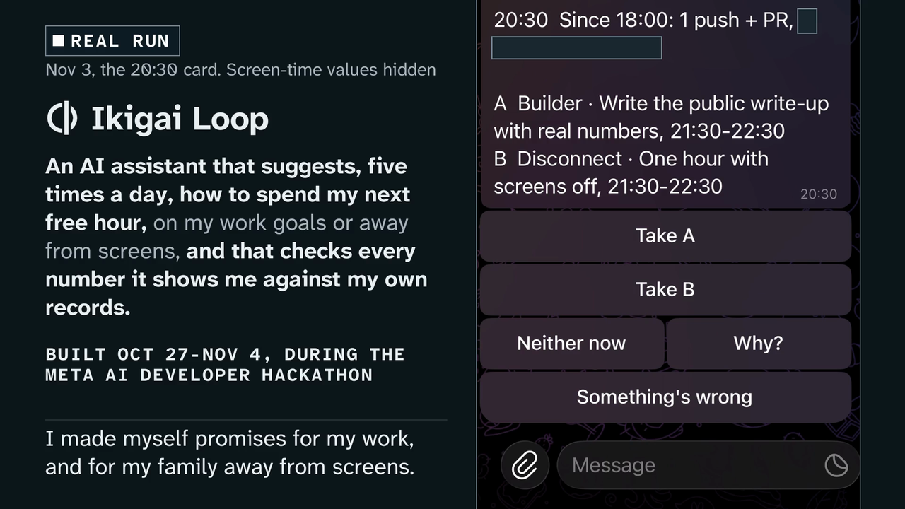
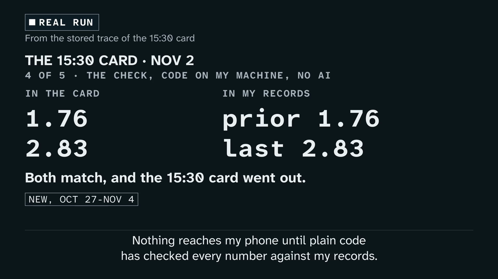
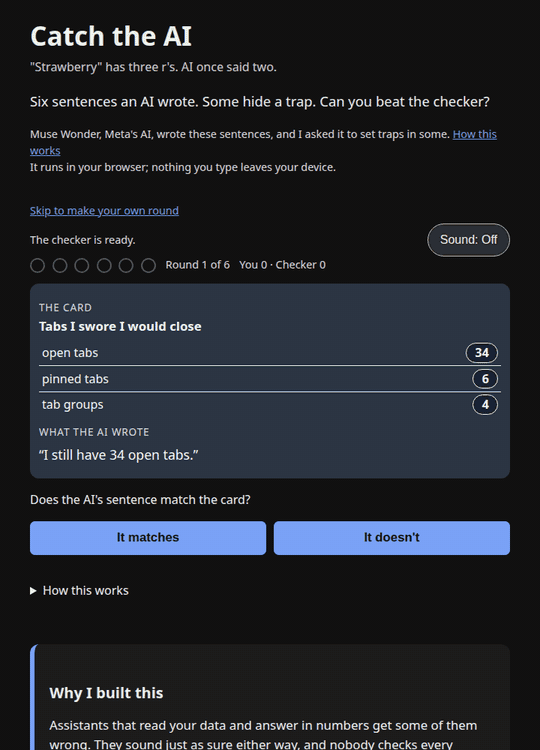

# My phone shows nothing until plain code checks the AI's numbers

*5 November 2026 · Nine days of building and three days of running an assistant on myself, mistakes and all*

*Claude helped with an early draft and fact-checked every number against the repo.*

## The challenge

Large language models can echo your own information back at you with subtle inaccuracies. The statements feel confident, the figures look plausible, and the errors slip by unnoticed.

I learned this firsthand while trying to manage my limited free time between family and work. Instead of another app for abstract life goals, I wanted a system that suggests one concrete action for my next free hour, something I can trust. For the Meta AI Developer Hackathon I built Ikigai Loop in nine days and ran it on myself for three.

## Functionality

The assistant checks in five times a day, at 1:30, 3:30, 6:00, 8:30 and 10:30 p.m., offering me two choices for my next free hour: one for work and one for family. Each suggestion comes with evidence from my own records: screen time, calendars and GitHub activity. I can pick one with a tap or give a spoken update to refresh the recommendation.

<figure style="margin: 1.6em 0;"><figcaption style="font-size: 14px; color: var(--muted); margin-top: 8px;">Real card from Nov 3 at 8:30 p.m.; screen-time values hidden.</figcaption></figure>

Three Meta models power the system, each applied where it makes the most sense:

- **Muse Glimmer** runs locally on my DGX Spark (GB10) and turns raw activity records into facts that cite their events. My raw records never leave the machine.
- **Muse Wonder** writes the recommendation cards from those facts and my short list of promises.
- **Muse Spark** turns a spoken correction into one typed edit to my list.

## Core rule: plain code checks the numbers

I trust the assistant only because nothing reaches my phone until plain code, not a model, checks the figures, sources and time windows each sentence cites against my records. If something doesn't match, the card is blocked, and the model retries once.

Why code? AI text can sound authoritative while misquoting data, and checking against the source catches it. A model reviewing another model would just shift the problem.

<figure style="margin: 1.6em 0;"><figcaption style="font-size: 14px; color: var(--muted); margin-top: 8px;">Verification on the Nov 2, 3:30 p.m. card.</figcaption></figure>

The [public demo](https://carloscrespomacaya.com/ikigai-loop/verify/) shows how the checker works. If a card says "November deploys: 7" but the sentence claims "Deploys reached 12 in November," the result is:

```text
FAIL. Caught a mistake.
"Deploys reached 12 in November."
The sentence says 12; the card says 7.
Code: L1B_METRIC_VALUE_MISMATCH
```

## The slip

On Nov 2, a card read "Prs rose by 3 in the last period." The number was correct, but it came from the wrong time window. That day, five more sentences made the same mistake, and the gate passed all six, because the numbers matched even though the windows didn't. I wrote a test that fails on that sentence first, then the rule that makes the gate catch it. Every miss I found is logged publicly in [TRUST.md](https://github.com/macayaven/ikigai-loop/blob/main/docs/TRUST.md). One is still open: calendar busy time isn't treated as hours, so a false sentence giving it in minutes can pass.

## Metrics and misses

Before going live, I [registered my predictions](https://github.com/macayaven/ikigai-loop/blob/main/docs/PREREG.md) and kept every outcome, successes and failures alike:

- **Live run (Nov 2 to 4):** all 13 scheduled cards went out on time; 1 of 25 first drafts failed the gate and passed on retry. No fallback card was needed. ([live-run.md](https://github.com/macayaven/ikigai-loop/blob/main/docs/live-run.md))
- **Known-answer datasets (UCI bike-share and home energy):** the checker flagged 120 of 120 planted errors and accepted 38 of 38 correct statements. ([domains.md](https://github.com/macayaven/ikigai-loop/blob/main/docs/domains.md))
- **Prompt test, same gate:** Muse Wonder's first draft failed once in 54 cases with my prompt, against 44 times with a plain one. ([r1b.md](https://github.com/macayaven/ikigai-loop/blob/main/docs/r1b.md))
- **Voice edits (60 frozen cases):** Muse Spark got 58 right at a median 2.48 s; a literal matcher got 13. Spoken in my cloned voice, 50 of 60 came out right from audio against 58 from text, and every audio miss asked again instead of making a wrong edit. ([r9-audio.md](https://github.com/macayaven/ikigai-loop/blob/main/docs/r9-audio.md))
- **Calendar titles (80 invented ones):** Muse Glimmer labelled 77 correctly; a keyword rule, 51. ([glimmer-evidence.md](https://github.com/macayaven/ikigai-loop/blob/main/docs/glimmer-evidence.md))

Two outcomes went against me:

1. Only 1 of the 7 checkable promises I accepted shows a completion in my records. Tapping a card is not doing the task.
2. My predictive learner did worse than two simple baselines.

## Public checker

Anyone can try the [browser-based checker](https://carloscrespomacaya.com/ikigai-loop/verify/). It starts as a mini-game, Catch the AI, where you judge whether sample sentences match their cards. Some hide planted traps, and one round hides a trap the checker misses: the same kind of time-window error that got through on Nov 2.

<figure style="margin: 1.6em 0;"><figcaption style="font-size: 14px; color: var(--muted); margin-top: 8px; text-align: center;">Sample rounds of Catch the AI.</figcaption></figure>

Below the game, you can test your own sentences against a card and see what each number was checked against. Opt-in saving helps me track where the checker fails.

One early outside tester couldn't tell whether the sentence or the card was authoritative. By evening, the page made it explicit: the card is the source of truth.

## Build process

I didn't handwrite the system. Muse Code, Meta's coding agent, wrote the code from written prompts, in Contributor mode on a public repo with synthetic data. Until Oct 31, I ran every session myself. From Nov 1, Claude Code wrote the prompts, ran the sessions and reviewed the results, while I made the calls. Outside reviews came from GPT models through Codex, Muse Wonder Full and Grok. [CONTRIBUTIONS.md](https://github.com/macayaven/ikigai-loop/blob/main/CONTRIBUTIONS.md) logs who wrote what, prompts included.

Two safeguards protected the evaluations: test sets were frozen before any implementation session could read them, and the coding sessions never opened the held-out folder.

An expensive day taught me to cap API spending. With no cap on the key, parallel sessions overspent in one day, so I revoked the key and moved every model call to my Muse Code subscription.

## Privacy focus

Raw records stay local. Muse Glimmer's open weights make private inference possible. The event database, the card log and the bot token live on my DGX Spark, and the card-writing model only sees derived facts and my promises. The public checker runs in your browser, with optional saving. ([PRIVACY.md](https://github.com/macayaven/ikigai-loop/blob/main/docs/PRIVACY.md))

## Try it

If you work on evals, agents or model reliability, I'd value your attempt to break it.

- Play the checker: [carloscrespomacaya.com/ikigai-loop/verify](https://carloscrespomacaya.com/ikigai-loop/verify/)
- The 3-minute demo: [youtu.be/OWPNDV5kOsY](https://youtu.be/OWPNDV5kOsY)
- Code, tests and every miss: [github.com/macayaven/ikigai-loop](https://github.com/macayaven/ikigai-loop)

*I'm Carlos Crespo Macaya. I build and evaluate AI systems, and Ikigai Loop is a personal project.*
